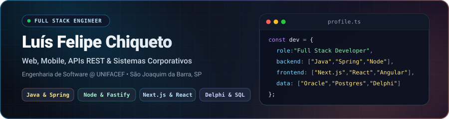

  

 

  
  
  
  

 

## 👨‍💻 Sobre Mim

Graduando em **Engenharia de Software** pela **UNIFACEF** (2023–2026), com formação técnica em **Desenvolvimento de Sistemas** pelo **SENAI** e pela **ETEC Pedro Badran**.

Atuo no desenvolvimento **Full Stack** de aplicações ponta a ponta — desde APIs robustas e arquitetura backend em **Java (Spring Boot)** e **Python (FastAPI)** até interfaces web reativas com **Next.js**, **React** e **Angular**, além de ecossistemas **Mobile / WearOS**, **Digital Twins 3D** e **Visão Computacional**.

- 🏢 **Experiência prática:** Desenvolvimento de sistemas corporativos com **Angular**, automação e sistemas embarcados na **Usina Alta Mogiana**, além de atuação prévia em sistemas ERP na **ACEDATA Software**.
- 🚀 **Foco atual:** Produtos SaaS completos, arquiteturas com IA (RAG & Visão Computacional), aplicações em tempo real e renderização 3D na web.
- 📫 **Contato direto:** `lfchiqueto@gmail.com`

---

## 🚀 Projetos em Destaque

| Projeto | Descrição | Stack Principal | Links |
| :--- | :--- | :--- | :--- |
| **Marca-lá** | SaaS completo de agendamentos online para negócios de serviços, com links por loja, dashboard financeiro, notificações push e pagamentos integrados. | `Java 21` `Spring Boot` `Next.js` `PostgreSQL` `Docker` `Cloudflare R2` `Asaas` | [Site](https://usemarcala.com.br/) |
| **Trainvy (FIT.AI)** | Plataforma com IA (arquitetura RAG sobre literatura cinesiológica) para prescrição e periodização de treinos com visualização 3D biomecânica. | `Next.js` `TypeScript` `TailwindCSS` `PostgreSQL` `PLpgSQL` | [App](https://trainvy.vercel.app/) · [Repo](https://github.com/Chiqueto/trainvy-frontend) |
| **SetVision** | Plataforma de visão computacional com **YOLO11** e **OpenCV** para rastreamento de trajetórias e análise técnica de treinos de vôlei. | `Python` `FastAPI` `OpenCV` `YOLO11` `Next.js` `TypeScript` | [Repo](https://github.com/Chiqueto/Set-Vision) |
| **SmartRep (TCC)** | Ecossistema IoT & Wearable com app **WearOS** para telemetria inercial, app mobile e backend corporativo para validação de repetições. | `Kotlin` `WearOS` `React Native` `Java` `Spring Boot` `PostgreSQL` `Docker` | [Repo](https://github.com/Chiqueto/SmartRepMobile) |
| **Gym Twin & Biomecânica 3D** | Gêmeo digital interativo de academia e simulador biomecânico 3D de Hack 45° com física e telemetria de força em tempo real. | `Three.js` `React Three Fiber` `Next.js` `TypeScript` | [Demo](https://gym-twin-frontend.vercel.app/) · [Repo](https://github.com/Chiqueto/digital-twin) |
| **Papo Torto** | Party game multiplayer de blefe e dedução social em tempo real com sincronização distribuída de salas e votações. | `Next.js` `TypeScript` `WebSocket` `Redis` `PostgreSQL` | [Jogar](https://papo-torto.vercel.app) · [Repo](https://github.com/Chiqueto/Papo_Torto) |
| **Class Line Backend** | API REST corporativa para gestão acadêmica e escolar com autenticação stateless JWT, Docker e documentação OpenAPI. | `Java 21` `Spring Boot 3` `PostgreSQL` `Docker` `Swagger` | [Swagger](https://classline-backend.onrender.com/swagger-ui/index.html) · [Repo](https://github.com/Chiqueto/ClassLine-Backend) |

---

## 🛠️ Stack & Ferramentas

### Backend & APIs

  
  
  
  
  
  
  

### Frontend, 3D & Web

  
  
  
  
  
  
  

### Mobile & Wearables

  
  
  

### Bancos de Dados & Cache

  
  
  
  

### Cloud, IA, Visão Computacional & Ferramentas

  
  
  
  
  
  
  
  

---

## 📊 GitHub Metrics

  

